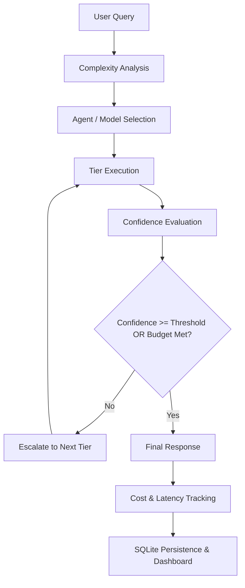
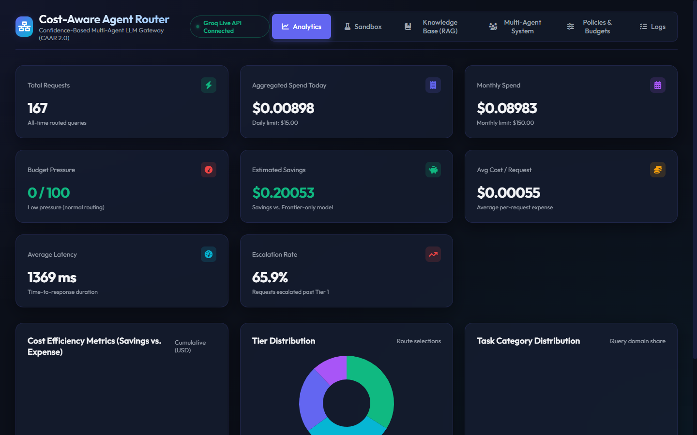
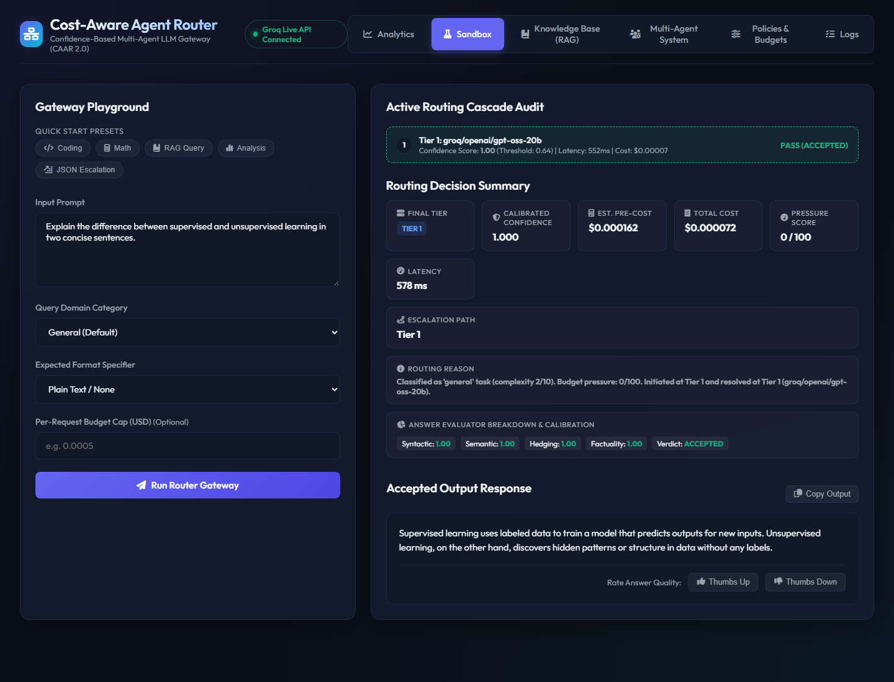
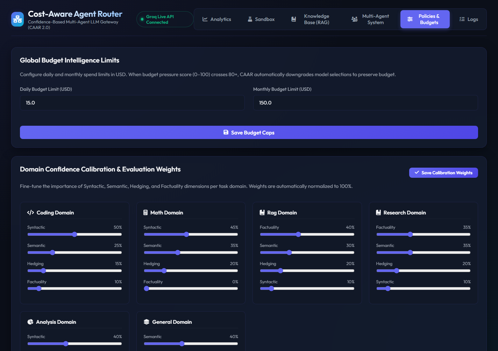
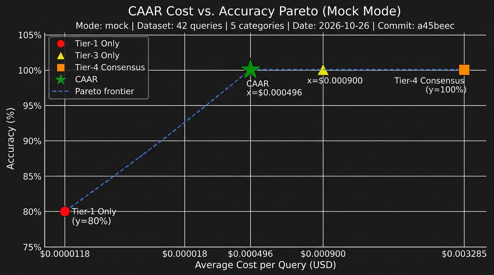

# Cost-Aware Agent Router (CAAR)

[](https://www.python.org/)
[](https://fastapi.tiangolo.com/)
[](LICENSE)
[](https://github.com/MuzraFatima/Cost-aware-agent/actions/workflows/ci.yml)
[](#-benchmark-results)

A confidence-based, multi-tier LLM routing system that dynamically routes queries to the lowest-cost capable agent and escalates only when confidence is insufficient.

---

## 💡 Why CAAR?

* **Lower Unnecessary LLM Inference Cost**: Reduces API spend by routing simple and structured tasks to high-throughput, low-cost tiers instead of frontier models.
* **Avoid Frontier Over-Provisioning**: Prevents routing routine factual queries to expensive frontier endpoints.
* **Automatic Difficulty Escalation**: Dynamically promotes complex reasoning, failed syntax, or hedging responses to higher-capability agent tiers.
* **Measurable Trade-offs**: Quantifies trade-offs across cost, latency, and accuracy with token-level accounting.
* **Auditable Routing Paths**: Provides step-by-step audit logs, confidence scores, and token spend per execution.
* **Offline Mock & Live Provider Modes**: Operates with zero configuration out-of-the-box using deterministic offline simulations, with optional support for live frontier LLM providers (OpenAI, Anthropic, Gemini).

---

## 🎯 Problem Statement & Motivation

Modern Large Language Model (LLM) deployments face a critical cost-versus-capability dilemma:

* **Cost Inefficiency**: Frontier LLMs (e.g., GPT-4o) offer high accuracy and robust instruction following but cost orders of magnitude more per token and incur higher latency. Sending every routine or simple factual query to a frontier model wastes substantial compute budget.
* **Quality Compromises**: Lightweight models (e.g., GPT-4o-mini) are cost-effective and fast, but they frequently fail on complex multi-step reasoning, strict JSON structured output requirements, or domain-specific tasks.
* **Variable Query Complexity**: Real-world query distributions are heterogeneous. A significant fraction of production queries can be satisfied by lower-cost tiers, while only a subset truly requires multi-agent consensus or frontier-tier reasoning.

Uniformly routing all requests to either extreme results in either unacceptable API expenses or compromised output reliability.

### How CAAR Solves This

CAAR addresses this challenge by combining:
* **Complexity-aware initial routing** to start queries at the most appropriate baseline tier.
* **Confidence-based acceptance** evaluating structural validity and epistemic certainty.
* **Dynamic escalation** across a multi-tier agent cascade when confidence is insufficient.
* **Cost tracking** with granular token-level expenditure accounting.
* **Latency tracking** across every execution step.
* **Audit logging** for transparent decision tracing.
* **Multi-tier agents** specialized for different task complexities.

---

## 🧠 How It Works

The routing pipeline follows a deterministic and observable execution flow:



### Core Routing Pipeline

1. **User Query Ingestion**: The client submits a prompt with optional domain classification, format expectations (`json`, `python`), and budget limits.
2. **Complexity Analysis**: Evaluates whether the prompt can start at Tier 1 (Cheap) or requires higher baseline capability (e.g., starting at Tier 2 for knowledge retrieval, Tier 3 for coding/math, or Tier 4 for audit-grade tasks).
3. **Agent/Model Selection & Tier Execution**: The chosen agent executes the prompt using either local mock simulation or real LLM providers via LiteLLM.
4. **Confidence Evaluation**: `ConfidenceEvaluator` calculates a composite confidence score:
   - **Syntactic Analysis**: Validates structural compliance (strict JSON schema / Python syntax checks).
   - **Semantic Hedging**: Scans for uncertainty phrases (e.g., *"I am not sure"*, *"probably"*, *"cannot guarantee"*).
5. **Accept or Escalate**:
   - If confidence meets or exceeds the domain policy threshold, the response is accepted.
   - If confidence is insufficient and budget allows, execution dynamically escalates to the next tier.
6. **Final Response & Audit Logging**: Returns the generated text, audit trail, execution path, token counts, latency measurements, and monetary savings against frontier baselines.

---

## ✨ Key Features

* **Confidence-Based Routing**: Combines syntactic verification and semantic hedging detection to quantify output reliability before acceptance.
* **Multi-Agent Tier Execution**:
  - **Tier 1 (Cheap Agent)**: High-speed, low-cost baseline (small model — `groq/openai/gpt-oss-20b`).
  - **Tier 2 (RAG Agent)**: Retrieval-augmented agent for context-grounded queries (small model — `groq/openai/gpt-oss-20b`).
  - **Tier 3 (Frontier Agent)**: High-precision large-model single call (large model — `groq/openai/gpt-oss-120b`) for complex coding and reasoning.
  - **Tier 4 (Consensus Agent)**: Multi-agent verification loop with critic pass for mission-critical tasks (large model — `groq/openai/gpt-oss-120b`).
* **Dynamic Escalation**: Seamlessly promotes under-confident responses to higher tiers without manual intervention.
* **Granular Cost Tracking**: Token-level expenditure calculation with local pricing tables and LiteLLM fallback rates.
* **Latency & Token Usage Profiling**: Wall-clock latency and token breakdown (input/output) recorded per execution step.
* **Zero-Config Mock / Sandbox Mode**: Fully deterministic built-in offline engine allowing complete local testing without external API keys.
* **Optional Real LLM Integration**: Multi-provider support (OpenAI, Anthropic, Gemini, **Groq**) via unified LiteLLM client orchestration.
* **Built-in Benchmark & Evaluation Framework**: Automated evaluation harness measuring accuracy (with 95% Wilson CI), cost, latency, and escalation rates across multiple strategies.
* **FastAPI REST Backend**: Asynchronous REST API with structured Pydantic schemas, dependency injection, and SQLite ORM persistence.
* **Interactive Web Dashboard**: Live SPA interface featuring real-time analytics KPIs, sandbox testing, policy threshold sliders, and detailed routing log inspection.
* **Interactive Swagger / OpenAPI Documentation**: Auto-generated interactive API exploration and schema validation at `/docs`.

---

## 📸 Live Dashboard & Visual Demo

The Cost-Aware Agent Router includes an interactive, zero-dependency Single Page Application (SPA) dashboard running at `http://localhost:8000/`.

### 1. Real-Time Analytics & KPI Metrics
Visualizes aggregated token expenditure, daily/monthly budget caps, dynamic budget pressure gauges, cost savings vs. frontier-only baselines, average latency, and tier distributions.



### 2. Gateway Playground & Accepted Routing Cascade Audit
Demonstrates live query execution with high confidence, `PASS (ACCEPTED)` verification, sub-second latency (578ms), and minimal cost ($0.000072) via Groq API.



### 3. Policies & Budget Control Plane
Configures global daily and monthly spend limits, domain confidence weighting factors (Syntactic, Semantic, Hedging, Factuality), and manual minimum confidence threshold sliders.



---

## 🏗️ System Architecture

CAAR is structured into modular layers separating API routing, orchestration logic, agent implementations, evaluation, and data storage.

```
┌─────────────────────────────────────────────────────────────────────────┐
│                      Client / Web Dashboard (SPA)                       │
│                        http://localhost:8000/                           │
└────────────────────────────────────┬────────────────────────────────────┘
                                     │ HTTP REST
┌────────────────────────────────────▼────────────────────────────────────┐
│                       FastAPI Application Layer                         │
│   ┌─────────────────────┐  ┌──────────────────┐  ┌──────────────────┐  │
│   │ /api/v1/router      │  │ /api/v1/analytics│  │ /api/v1/config   │  │
│   └──────────┬──────────┘  └────────┬─────────┘  └────────┬─────────┘  │
└──────────────│──────────────────────│─────────────────────│─────────────┘
               │                      │                     │
┌──────────────▼──────────────────────▼─────────────────────▼─────────────┐
│                             Router Engine                               │
│  ┌──────────────────────────────────────────────────────────────────┐   │
│  │                    Complexity Pre-Classifier                     │   │
│  └──────────────────────────────────┬───────────────────────────────┘   │
│                                     │                                   │
│  ┌──────────────┐   ┌──────────────┐   ┌──────────────┐   ┌──────────┐  │
│  │    Tier 1    │   │    Tier 2    │   │    Tier 3    │   │  Tier 4  │  │
│  │ Cheap Agent  │──►│  RAG Agent   │──►│Frontier Agent│──►│Consensus │  │
│  └──────────────┘   └──────────────┘   └──────────────┘   └──────────┘  │
│         ▲                  ▲                  ▲                  ▲      │
│         └──────────────────┴─────────┬────────┴──────────────────┘      │
│                                      │                                  │
│                        Confidence Evaluator                             │
│                  (Syntactic + Semantic Hedging)                         │
└──────────────────────────────────────┬──────────────────────────────────┘
                                       │
┌──────────────────────────────────────▼──────────────────────────────────┐
│                   Persistence Layer (SQLite / SQLAlchemy)                │
│         routing_logs   │   routing_steps   │   routing_policies         │
└─────────────────────────────────────────────────────────────────────────┘
```

### Module Responsibilities

| Module | Source Location | Description |
|---|---|---|
| **App Entrypoint** | [`backend/app/main.py`](backend/app/main.py) | FastAPI lifecycle management, CORS configuration, route registration, and static dashboard mounting. |
| **Router Engine** | [`backend/app/core/router_engine.py`](backend/app/core/router_engine.py) | Coordinates cascade loops, complexity pre-classification, budget validation, and step aggregation. |
| **Confidence Evaluator** | [`backend/app/core/confidence.py`](backend/app/core/confidence.py) | Computes syntactic verification and semantic uncertainty scores. |
| **Answer Evaluator** | [`backend/app/core/answer_evaluator.py`](backend/app/core/answer_evaluator.py) | Domain-specific answer quality assessment and correctness scoring. |
| **Confidence Calibration** | [`backend/app/core/confidence_calibration.py`](backend/app/core/confidence_calibration.py) | Domain-adaptive weighting matrices; dynamically adjusts confidence thresholds by complexity and budget pressure. |
| **Multi-Agent Coordinator** | [`backend/app/core/multi_agent_coordinator.py`](backend/app/core/multi_agent_coordinator.py) | Orchestrates parallel multi-agent task execution and result synthesis. |
| **Configuration** | [`backend/app/core/config.py`](backend/app/core/config.py) | Pydantic-based environment settings, default domain thresholds, and mock mode detection. |
| **7 Agent Implementations** | [`backend/app/agents/`](backend/app/agents/) | `CheapAgent` (T1), `RAGAgent` (T2), `FrontierAgent` (T3), `ConsensusAgent` (T4), `CodingAgent`, `ResearchAgent`, `AnalysisAgent` and deterministic mock library. |
| **API Endpoints** | [`backend/app/api/`](backend/app/api/) | `router.py` (completions/feedback), `analytics.py` (KPIs/logs), `config.py` (policies), `agents.py` (registry), `rag.py` (uploads), `evaluator.py` (benchmark trigger). |
| **Database & Models** | [`backend/app/db/`](backend/app/db/) | SQLAlchemy models (`RoutingLog`, `RoutingStep`, `RoutingPolicy`) and database initialization. |
| **Knowledge Base Service** | [`backend/app/services/knowledge_base.py`](backend/app/services/knowledge_base.py) | Term-frequency sparse vector indexing with cosine similarity search stored via SQLAlchemy. Supports `.txt`, `.md`, `.pdf`, `.json`, `.csv`. |
| **Cost Tracker** | [`backend/app/utils/cost_tracker.py`](backend/app/utils/cost_tracker.py) | Calculates input/output token pricing with local `gpt-oss-20b`/`gpt-oss-120b` tables and LiteLLM fallback. |
| **Evaluation Framework** | [`backend/app/evaluation/`](backend/app/evaluation/) | 42-query benchmark dataset (GSM8K/HumanEval/TriviaQA-sourced), 4-strategy runner, and Markdown/JSON report generator. |

*For deep architectural design and routing algorithms, refer to [ARCHITECTURE.md](docs/ARCHITECTURE.md) and [ROUTING_ALGORITHM.md](docs/ROUTING_ALGORITHM.md).*

---

## 📊 Benchmark Results

The evaluation framework was executed across a curated benchmark of **42 queries** distributed over **5 task categories** (Factual Questions, Coding, Mathematics, JSON / Structured Output, Reasoning & Verification). CAAR was evaluated against a fixed single-tier baseline (Tier 1 Only), a single large-model call baseline (Tier-3 Only), and a full multi-agent consensus baseline (Tier-4 Consensus Only).

On the project's 42-query mock-mode benchmark, CAAR achieved **100% accuracy** while reducing benchmark cost by **84.9%** compared with the Tier-4 Consensus Only baseline.

> **Cost basis** — mock-mode figures use the token pricing table in `backend/app/utils/cost_tracker.py`:
>
> | Model | Role | Input $/1M tokens | Output $/1M tokens |
> | :--- | :--- | :---: | :---: |
> | `groq/openai/gpt-oss-20b` | Tier 1 & 2 (small model) | $0.10 | $0.40 |
> | `groq/openai/gpt-oss-120b` | Tier 3 & 4 (large model) | $0.60 | $2.40 |
>
> The 84.9% savings figure compares CAAR's weighted per-query cost against the Tier-4 Consensus Only baseline (every query through the full consensus loop).

### Executive Comparison

| Metric | Tier-1-Only | Tier-3 Only (Single Frontier) | Tier-4 Consensus Only | CAAR (Dynamic Cascade) |
| :--------------------------- | :--------------------: | :---------------------------: | :--------------------: | :--------------------: |
| Success / Accuracy | 80.0% (16/20) | 100.0% (20/20) | 100.0% (20/20) | 100.0% (20/20) |
| Total Benchmark Cost | $0.000358 | $0.018000 | $0.065707 | $0.009928 |
| Cost Savings vs Tier-4 | 99.5% | 72.6% | 0.0% | **84.9%** |
| Cost Savings vs Tier-3 | 98.0% | 0.0% | — | **44.8%** |
| Average Cost per Query | $0.000018 | $0.000900 | $0.003285 | $0.000496 |
| Average Latency | 403 ms | 1002 ms | 2002 ms | 985 ms |
| Escalation Rate | 0.0% | 0.0% | 0.0% | 15.0% |

> [!NOTE]
> **Evaluation Disclaimer**: Figures are from mock-mode runs (`run_benchmark.py`, mode: mock, date: 2026-10-26, commit: `a45beec`, dataset: 42 queries across 5 categories). Mock responses use deterministic token cost tables — they are reproducible but are **not** live API measurements. Run with `--live` for real provider latency and cost data.

---

## 📊 Cost vs. Accuracy Pareto



*CAAR (green star) lies on the Pareto frontier: it matches Tier-4 Consensus accuracy (100%) at 85% lower cost per query.*

---

## 🧪 Evaluation Categories

The benchmark suite assesses routing effectiveness across 5 distinct domains:

| Category | Description | Primary Failure Mode of Low Tier | CAAR Resolution Mechanism |
|---|---|---|---|
| **Factual Questions** | General world knowledge and geography lookups. | Minimal (Tier 1 succeeds). | Resolved directly at Tier 1 (lowest cost and latency). |
| **Coding** | Python function and algorithm generation. | Syntax errors or missing docstrings. | Escalates to Tier 3 when syntax verification fails. |
| **Mathematics** | Arithmetic calculations and multi-step word problems. | Calculation slips and unverified logic. | Complexity pre-classifier routes to Tier 3/4. |
| **JSON / Structured Output** | Strict JSON schema generation with nested fields. | Malformed syntax / non-JSON wrappers. | Syntactic parser triggers instant hard escalation to Tier 3. |
| **Reasoning & Verification** | Multi-step deductions and truth verification. | Semantic hedging and incomplete proofs. | Hedging detector triggers consensus verification. |

### Category-Wise Performance Summary

| Category | Tier 1 Accuracy | Tier-3 Only Accuracy | Tier-4 Accuracy | CAAR Accuracy | CAAR Avg Cost | CAAR Avg Latency |
| :--- | :---: | :---: | :---: | :---: | :---: | :---: |
| **Coding** | 100% | 100% | 100% | **100%** | $0.000986 | 1206 ms |
| **Factual** | 100% | 100% | 100% | **100%** | $0.000012 | 404 ms |
| **JSON** | 0% | 100% | 100% | **100%** | $0.000267 | 1056 ms |
| **Mathematics** | 100% | 100% | 100% | **100%** | $0.000241 | 1204 ms |
| **Reasoning** | 100% | 100% | 100% | **100%** | $0.000976 | 1056 ms |

* **Coding**: Maintained 100% accuracy via syntax verification and selective frontier tier escalation when required (avg cost: $0.000986, avg latency: 1206 ms).
* **Factual**: Resolved directly at Tier 1 with minimal cost and fast response times (avg cost: $0.000012, avg latency: 404 ms).
* **JSON**: Tier 1 failed completely on strict structural formatting (0%), while CAAR detected syntactic errors and escalated to achieve 100% accuracy (avg cost: $0.000267, avg latency: 1056 ms).
* **Mathematics**: Maintained 100% precision across multi-step numerical queries (avg cost: $0.000241, avg latency: 1204 ms).
* **Reasoning**: Complex multi-step reasoning handled reliably with epistemic verification (avg cost: $0.000976, avg latency: 1056 ms).

*For detailed evaluation methodologies and validation logic, refer to [EVALUATION.md](docs/EVALUATION.md).*

---

## 🧪 Testing

The repository maintains an automated test suite verifying routing policies, API endpoints, LLM integration fallbacks, and evaluation integrity.

```bash
# bash / Linux / macOS
python -m pytest
```

```powershell
# PowerShell / Windows
python -m pytest
```

### Verified Test Suite Result

```
collected 70 items

tests/test_benchmark.py .........       [12%]
tests/test_budget.py ....               [18%]
tests/test_e2e_live_path.py ........    [29%]
tests/test_evaluator.py ........        [40%]
tests/test_llm_integration.py ......    [49%]
tests/test_multi_agent.py ...           [53%]
tests/test_rag.py .......               [63%]
tests/test_router.py ................   [100%]

============================== 70 passed, 8 warnings in 92.20s ============================
```

*Mode: mock | Python 3.14 | Date: 2026-10-26 | Commit: `a45beec`*

* **70 Passed**: All unit tests, routing logic tests, confidence evaluators, mock fallback paths, and database persistence checks pass completely.
* **8 Warnings**: Deprecation notices from `litellm` async logging and `pydantic` v2 class-based config; do not affect test outcomes.

---

## 🛠️ Technology Stack

| Layer / Component | Technology | Purpose |
|---|---|---|
| **Backend Framework** | [FastAPI](https://fastapi.tiangolo.com/) (`>=0.100.0`) | High-performance asynchronous REST API framework. |
| **ASGI Web Server** | [Uvicorn](https://www.uvicorn.org/) (`>=0.22.0`) | Production ASGI server implementation. |
| **LLM Gateway** | [LiteLLM](https://github.com/BerriAI/litellm) (`>=1.0.0`) | Multi-provider LLM API abstraction (OpenAI, Anthropic, Gemini). |
| **Data Validation** | [Pydantic v2](https://docs.pydantic.dev/) & `pydantic-settings` | Request/response schema validation and environment management. |
| **ORM & Persistence** | [SQLAlchemy 2.0](https://www.sqlalchemy.org/) & [aiosqlite](https://github.com/omnilib/aiosqlite) | Relational ORM mapping for SQLite log/policy storage. |
| **HTTP Client** | [HTTPX](https://www.python-httpx.org/) (`>=0.24.0`) | Asynchronous HTTP client for live testing and external calls. |
| **Testing** | [Pytest](https://docs.pytest.org/) & `pytest-asyncio` | Unit, integration, and asynchronous test runner. |
| **Frontend UI** | HTML5, Modern Vanilla CSS, Vanilla JavaScript | Zero-dependency responsive Single Page Application (SPA). |
| **Runtime Environment** | Python 3.10+ | Supported on Windows, macOS, and Linux. |

---

## 📁 Project Structure

```
cost-aware-agent-router/
├── backend/
│   ├── app/
│   │   ├── agents/               # Tiered agent implementations (T1–T4) & mock catalog
│   │   │   ├── __init__.py
│   │   │   ├── _mock_answers.py  # Deterministic offline mock responses
│   │   │   ├── analysis_agent.py # Specialised analysis agent
│   │   │   ├── base.py           # Base agent interface
│   │   │   ├── cheap_agent.py    # Tier 1: Fast/cheap agent (gpt-oss-20b small model)
│   │   │   ├── coding_agent.py   # Specialised coding agent
│   │   │   ├── consensus_agent.py# Tier 4: Multi-agent consensus loop (gpt-oss-120b)
│   │   │   ├── frontier_agent.py # Tier 3: High-capability large-model agent (gpt-oss-120b)
│   │   │   ├── rag_agent.py      # Tier 2: Knowledge-augmented agent (gpt-oss-20b)
│   │   │   └── research_agent.py # Specialised research agent
│   │   ├── api/                  # FastAPI REST endpoints
│   │   │   ├── agents.py         # Agent registry and status endpoint
│   │   │   ├── analytics.py      # Analytics KPI and log retrieval routes
│   │   │   ├── config.py         # Dynamic policy configuration routes
│   │   │   ├── evaluator.py      # Benchmark trigger API endpoint
│   │   │   ├── rag.py            # Document upload and knowledge-base routes
│   │   │   └── router.py         # Query completion and user feedback routes
│   │   ├── core/                 # Core engine and configuration
│   │   │   ├── answer_evaluator.py    # Answer quality evaluation helpers
│   │   │   ├── confidence.py          # Syntactic and semantic hedging evaluators
│   │   │   ├── confidence_calibration.py # Domain-adaptive weight calibration service
│   │   │   ├── config.py              # Environment variables & threshold settings
│   │   │   ├── multi_agent_coordinator.py # Multi-agent task orchestration
│   │   │   └── router_engine.py       # Cascade loop, complexity classifier & tracking
│   │   ├── db/                   # Database schemas and session management
│   │   │   ├── models.py         # SQLAlchemy ORM models (RoutingLog, RoutingStep, RoutingPolicy)
│   │   │   └── session.py        # Database session factory & schema migration helper
│   │   ├── evaluation/           # Benchmark framework
│   │   │   ├── dataset.py        # 42-query evaluation dataset (GSM8K, HumanEval, TriviaQA)
│   │   │   ├── evaluator.py      # Multi-strategy benchmark runner & validators
│   │   │   └── formatter.py      # Markdown benchmark report generator
│   │   ├── services/             # Business-layer services
│   │   │   └── knowledge_base.py # Term-frequency sparse retrieval & SQLAlchemy chunk store
│   │   ├── static/               # Interactive web dashboard
│   │   │   ├── app.js            # Dashboard logic, charts, and API interactions
│   │   │   ├── index.html        # Dashboard layout and tab views
│   │   │   └── style.css         # Modern design tokens and styling
│   │   ├── utils/                # Utility modules
│   │   │   ├── cost_tracker.py   # Token pricing and cost estimation helpers
│   │   │   └── llm_client.py     # Centralised LiteLLM client key propagation
│   │   └── main.py               # FastAPI application entrypoint
│   └── requirements.txt          # Python dependencies (tested on Python 3.11)
├── .github/
│   └── workflows/
│       └── ci.yml                # GitHub Actions CI (Python 3.11 & 3.12, mock mode)
├── docs/                         # Extended project documentation
│   ├── ARCHITECTURE.md           # Detailed component architecture and DB schemas
│   ├── DEMO.md                   # Step-by-step interactive demo script
│   ├── EVALUATION.md             # Benchmark methodology and evaluation design
│   ├── ROUTING_ALGORITHM.md      # Mathematical logic for confidence & escalation
│   └── pareto.png                # Cost vs. accuracy Pareto chart
├── tests/                        # Automated Pytest suite (8 test files, 70 tests)
│   ├── test_benchmark.py         # Evaluation dataset and validator tests
│   ├── test_budget.py            # Budget limit and pressure tests
│   ├── test_e2e_live_path.py     # Full end-to-end agent execution tests
│   ├── test_evaluator.py         # Answer evaluator unit tests
│   ├── test_llm_integration.py   # Environment and LiteLLM integration tests
│   ├── test_multi_agent.py       # Multi-agent coordinator tests
│   ├── test_rag.py               # RAG knowledge base tests
│   └── test_router.py            # Routing engine, cascade, and evaluator tests
├── .env.example                  # Environment configuration template
├── .gitignore                    # Git ignore specifications
├── BENCHMARK_REPORT.md           # Auto-generated benchmark report artifact
├── LICENSE                       # MIT License
├── README.md                     # Project documentation
└── run_benchmark.py              # CLI benchmark execution script (--live, --runs N)
```

---

## 🚀 Installation & Setup

### 1. Clone the Repository

```bash
git clone https://github.com/MuzraFatima/Cost-aware-agent.git
cd Cost-aware-agent
```

```powershell
# PowerShell equivalent
git clone https://github.com/MuzraFatima/Cost-aware-agent.git
cd Cost-aware-agent
```

### 2. Create and Activate Virtual Environment

```bash
# bash / macOS / Linux
python -m venv venv
source venv/bin/activate
```

```powershell
# PowerShell / Windows
python -m venv venv
venv\Scripts\Activate.ps1
```

### 3. Install Dependencies

> Tested on **Python 3.11** and **Python 3.12**.

```bash
pip install -r backend/requirements.txt
```

### 4. Configure Environment

```bash
# bash
cp .env.example .env
# Edit .env — add your GROQ_API_KEY for live mode, or leave defaults for mock mode
```

```powershell
# PowerShell
Copy-Item .env.example .env
# Edit .env — add your GROQ_API_KEY for live mode, or leave defaults for mock mode
```

The `.env` file with the Groq defaults (no changes needed for mock mode):

```ini
GROQ_API_KEY=gsk_...

TIER_1_MODEL=groq/openai/gpt-oss-20b
TIER_2_MODEL=groq/openai/gpt-oss-20b
TIER_3_MODEL=groq/openai/gpt-oss-120b
TIER_4_MODEL=groq/openai/gpt-oss-120b

DATABASE_URL=sqlite:///./caar.db
```

### 5. Start the Application Server

```bash
python -m uvicorn backend.app.main:app --reload
```

```powershell
# PowerShell equivalent
python -m uvicorn backend.app.main:app --reload
```


Once running, access the services:
* **Interactive Web Dashboard**: [http://localhost:8000/](http://localhost:8000/)
* **Interactive Swagger / OpenAPI UI**: [http://localhost:8000/docs](http://localhost:8000/docs)
* **Alternative ReDoc Documentation**: [http://localhost:8000/redoc](http://localhost:8000/redoc)

---

## 🔑 LLM API Configuration (Groq & Multi-Provider)

CAAR operates with **zero configuration out-of-the-box in Mock Mode**. If no keys are provided, the system executes deterministic offline simulations with realistic simulated latency and token costs.

### Live High-Speed Inference with Groq API
The system is natively optimized for **Groq API** for ultra-fast, cost-effective inference:

1. Copy `.env.example` to `.env`:
   ```bash
   # bash
   cp .env.example .env
   ```
   ```powershell
   # PowerShell
   Copy-Item .env.example .env
   ```
2. Set your `GROQ_API_KEY` inside `.env`:
   ```ini
   # Groq API Key (High-throughput, low-latency live inference)
   GROQ_API_KEY=gsk_...

   # Groq Model per Tier (small model for T1/T2, large model for T3/T4)
   TIER_1_MODEL=groq/openai/gpt-oss-20b
   TIER_2_MODEL=groq/openai/gpt-oss-20b
   TIER_3_MODEL=groq/openai/gpt-oss-120b
   TIER_4_MODEL=groq/openai/gpt-oss-120b
   ```

When `GROQ_API_KEY` is configured, CAAR immediately transitions to live mode and the dashboard header displays **`● Groq Live API Connected`**.

*(Note: Live keys are strictly optional. Never commit `.env` containing live credentials to git).*

---

## 📈 Running Tests

Execute the full automated test suite verifying routing policies, API endpoints, LLM integration, and benchmark validators:

```bash
python -m pytest
```

To run with verbose per-test reporting:

```bash
python -m pytest -v
```

---

## 📊 Running the Benchmark

Execute the automated multi-strategy benchmark suite:

```bash
# Mock mode (default — no API keys needed)
python run_benchmark.py

# Live API mode (requires GROQ_API_KEY in .env)
python run_benchmark.py --live

# 3 repeated runs with 95% Wilson CI on accuracy
python run_benchmark.py --runs 3
```

The script evaluates the 42 benchmark queries across Tier-1-Only, Tier-3-Only, Tier-4-Consensus-Only, and CAAR Dynamic Cascade strategies, outputting comparative metrics to the console and regenerating [`BENCHMARK_REPORT.md`](BENCHMARK_REPORT.md).

---

## 🖥️ Interactive Dashboard & API Control Plane

The web application served at `http://localhost:8000/` provides a comprehensive 6-tab control plane:

* ⚡ **Analytics Tab**: Real-time KPI summary cards (Total Requests, Aggregated Spend Today, Monthly Spend, Budget Pressure Gauge 0–100, Estimated Savings vs. Frontier-only, Average Latency, Escalation Rate) and interactive Chart.js visualizations (Cumulative Cost Savings, Tier Distribution, and Task Domain Share).
* 🧪 **Sandbox Tab (Gateway Playground)**: Interactive testing environment featuring quick-start preset chips (`Coding`, `Math`, `RAG Query`, `Analysis`, `JSON Escalation`), domain selector, format enforcement (`JSON`, `Python`), optional per-request budget caps, real-time step cascade visualization, calibrated confidence scoring, and one-click output clipboard copying with user feedback ratings.
* 📖 **Knowledge Base (RAG) Tab**: Document upload and sparse retrieval manager supporting `.txt`, `.md`, `.pdf`, `.json`, and `.csv`. Documents are stored as term-frequency sparse vectors with cosine similarity search via SQLAlchemy. Inspect indexed chunks, sizes, and ingestion timestamps powering Tier 2 context retrieval.
* 👥 **Multi-Agent System Tab**: Live fleet overview displaying all **7 specialized agents** (Cheap Direct Agent, Augmented RAG Agent, Specialized Analysis Agent, Specialized Coding Agent, Specialized Research Agent, Frontier Reasoning Agent, Consensus Loop Agent) with model bindings, cost profiles, and live Groq connection status badges.
* ⚙️ **Policies & Budgets Tab**: Global daily and monthly budget limit configuration with dynamic budget pressure throttling (auto-downgrading tiers when pressure > 80), domain confidence calibration sliders (Syntactic, Semantic, Hedging, Factuality weights), and per-domain minimum confidence threshold sliders persisted directly to SQLite.
* 📋 **Logs Tab**: Real-time searchable and tier-filterable audit log table. Expand any row (`▶`) to inspect full prompts, generated outputs, per-step latency, token counts, and step-by-step tier escalation reasons.

### Interactive Swagger / OpenAPI Documentation

The OpenAPI interface at `http://localhost:8000/docs` allows schema validation and endpoint testing:
* `POST /api/v1/router/completions`: Dispatches queries through the dynamic confidence cascade.
* `POST /api/v1/router/feedback`: Records user thumbs-up/thumbs-down feedback.
* `GET /api/v1/agents/registry`: Returns real-time status and metadata for all specialized agents.
* `GET /api/v1/analytics/summary`: Fetches aggregated cost, latency, budget pressure, and distribution KPIs.
* `GET /api/v1/analytics/logs`: Queries paginated routing history and step traces.
* `GET / POST /api/v1/config/policies`: Reads and updates active domain confidence thresholds.
* `POST /api/v1/rag/upload`: Ingests documents into the knowledge base vector store.

---

## 🔧 Troubleshooting

### Windows Port 8000 Binding Error (`[WinError 10013]`)
If Uvicorn exits with `[WinError 10013] An attempt was made to access a socket in a way forbidden by its access permissions`, port `8000` is already in use by another instance or process:

1. **Terminate the existing background process**:
   ```powershell
   Stop-Process -Id (Get-NetTCPConnection -LocalPort 8000).OwningProcess -Force
   ```
2. **Or run on an alternate port**:
   ```powershell
   python -m uvicorn backend.app.main:app --port 8001 --reload
   ```

---

## 📚 Documentation

Detailed technical references are available in the [`docs/`](docs/) directory:

* 🏗️ [**Architecture Reference**](docs/ARCHITECTURE.md): Database schemas, agent contracts, and design principles.
* 🎮 [**Interactive Demo Walkthrough**](docs/DEMO.md): Step-by-step instructions for demonstrating routing, JSON escalation, and policy adjustments.
* 📊 [**Evaluation Methodology**](docs/EVALUATION.md): Benchmark dataset composition, metric formulas, and validation logic.
* 🧮 [**Routing Algorithm Reference**](docs/ROUTING_ALGORITHM.md): In-depth breakdown of syntactic scoring, semantic hedging regex patterns, and the policy feedback loop.

---

## 🔬 Research & Engineering Significance

> **CAAR treats LLM inference as a cost-quality optimization problem.**

Dynamic multi-tier model routing addresses one of the fundamental scaling challenges in agentic AI: **inference cost and latency overhead**.

1. **Cost-Quality Optimization**: The system attempts to minimize inference cost while maintaining an acceptable confidence and quality level across heterogeneous workloads.
2. **Confidence-Gated Cascades**: By evaluating both structural validity (syntactic) and verbalized epistemic uncertainty (hedging markers), systems can safely delegate the vast majority of non-critical queries to small, high-throughput models without sacrificing reliability.
3. **Deterministic Fallbacks**: Decoupling routing policy thresholds into configurable domain rules allows system operators to set strict SLAs (e.g., higher confidence thresholds for mathematical or coding queries compared to creative generation).
4. **Transparent Audit Trails**: Storing full execution traces—including rejected low-tier outputs and escalation triggers—enables continuous observability, cost attribution, and policy refinement.

---

## 🔮 Future Improvements

- [ ] **Dense Vector RAG Backend**: Integrate dense vector databases (e.g., ChromaDB, Pinecone, Qdrant) into `RAGAgent` to replace the current term-frequency sparse cosine retrieval.
- [ ] **Asynchronous Judge LLM**: Incorporate an optional background LLM-as-a-Judge pass for semantic truthfulness verification.
- [ ] **Streaming Token Response Support**: Implement Server-Sent Events (SSE) / WebSocket streaming through the cascade pipeline.
- [ ] **Multi-Turn Contextual Routing**: Maintain conversation state across turns to dynamically adjust start tiers based on dialogue history.
- [ ] **Distributed Tracing**: Export OpenTelemetry spans to Jaeger or Prometheus for enterprise monitoring.
- [ ] **Containerization**: Provide official multi-stage `Dockerfile` and `docker-compose.yml` deployment templates.
- [ ] **Statistical Calibration**: Fit Platt scaling or isotonic regression on a held-out validation set to produce a proper reliability diagram.

---

## 📖 Related Work

CAARs multi-tier routing approach draws on and extends prior work in LLM cost optimization:

* **FrugalGPT** (Chen et al. 2023) introduced the idea of cascading LLM calls by routing queries to cheaper models first and escalating only when the cheaper model fails a quality gate. CAAR differs in that it uses **heuristic complexity pre-classification** (keyword density, prompt length, domain type) to choose a starting tier directly, rather than always starting at Tier 1 and checking confidence post-hoc. CAAR also tracks cost and latency per step and writes a full audit trail to SQLite.

* **RouteLLM** (Ong et al. 2024) trains a binary router that classifies queries as "easy" (cheap model) or "hard" (strong model) using preference data. CAAR's router (see [`router_engine.py`](backend/app/core/router_engine.py)) uses a **rule-based complexity pre-classifier** combining keyword patterns, task-type detection, and prompt length signals — requiring no training data or preference pairs, making it zero-shot deployable.

CAARs principal contribution is combining pre-classification, post-generation confidence gating, multi-agent consensus, and per-tier cost accounting into a single observable, configurable system with an interactive dashboard.

---

## ⚠️ Limitations

1. **Heuristic Confidence Misses Confidently Wrong Answers**: The `ConfidenceEvaluator` detects uncertainty phrases (hedging) and structural failures (syntax errors). It cannot detect a fluent, syntactically correct answer that is factually wrong. A confident but incorrect answer will pass the confidence gate and not be escalated.

2. **Small Benchmark**: The evaluation dataset contains 42 queries. While distributed across 5 categories and drawn from public benchmarks (GSM8K, HumanEval, TriviaQA), this sample size is insufficient to draw statistically robust conclusions about real-world accuracy. Use `--runs 3` or more to report Wilson confidence intervals.

3. **Mock-Mode Results Are Simulated**: Default benchmark figures come from mock mode, where responses are deterministic and costs are calculated from a local pricing table — not from live API calls. Live latency, token counts, and actual billing may differ substantially. Pass `--live` to `run_benchmark.py` for real measurements.

---

## 📜 License

This project is licensed under the **MIT License**. See the `LICENSE` file for details.

---

## 👩‍💻 Author

**Muzra Fatima**  
*B.Tech in Artificial Intelligence & Machine Learning*  
* **GitHub**: [@MuzraFatima](https://github.com/MuzraFatima)
* **Repository**: [Cost-aware-agent](https://github.com/MuzraFatima/Cost-aware-agent)